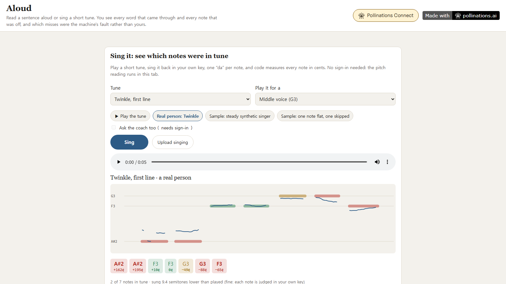

# Aloud

**Read it out or sing it, see what came through.** Live: https://patbing.github.io/aloud/

Open https://patbing.github.io/aloud/#sing-demo to land on the real singing take.

Pick a tongue twister or type your own sentence, then read it aloud. `openai/whisper-large-v3` writes down what it heard, with no hint of the sentence. Code lines that transcript up with the sentence word by word: heard right, heard as something else, not heard, or extra. Words per minute and pauses come from the recording itself.

The transcriber is tested too. A synthetic voice (`openai/tts-1`) reads the same sentence and the same transcriber writes it down. A word it gets wrong even from that clean reading is greyed out and not counted against you. A coach (`openai/gpt-5.4-nano`) then writes up to three tips from the scorecard only.

Without signing in you can replay recorded takes: a synthetic reader saying each sentence straight and with a planted slip, with the real transcripts and coaching from the recording run.

## Sing it

Pick a short tune, press Play, and sing it back in your own key, one "da" per note. Code reads your pitch every 20 ms in the browser (YIN), splits it into held notes, lines them up with the tune note by note and shows how many cents each one was off, on a pitch trace. Singing higher or lower than played is not a mistake: every key is tried and each note is judged against the key you chose. No sign-in and no model call: the coach is optional.

The pitch reader is tested too. It also reads a clean tone of the tune in your key mixed with the quietest part of your own take (your room). A note it misreads even then is greyed out and not counted; if it misreads most of them, the take is marked too noisy to score instead. Without a microphone you can score a real person singing Twinkle, and two code-made sample singers (one straight, one with a flat note and a skipped one).

## Run it

Static files, no build. Serve the folder (for example `npx serve`) and open it. Singing is scored in the browser with no sign-in. Sign in with Pollinations Connect to record speech or to ask the coach; you pay with your own Pollen and the defaults are free-tier models. The page will not send a take that could push one visit past 0.05 Pollen (`CAP` in `js/config.js`). Tests: `npm test`.

## Files

- `js/score.js` word alignment, transcriber baseline, pauses, the coach's scorecard (pure, tested)
- `js/pitch.js` pitch reading, note splitting, note-by-note comparison, the pitch-reader check, the singing scorecard (pure, tested)
- `js/audio.js` microphone to 16 kHz WAV in every browser, decoding of uploads
- `js/net.js` the only file that talks to `gen.pollinations.ai`
- `tools/record.mjs` makes the recorded takes, with a spend cap

MIT licence.
